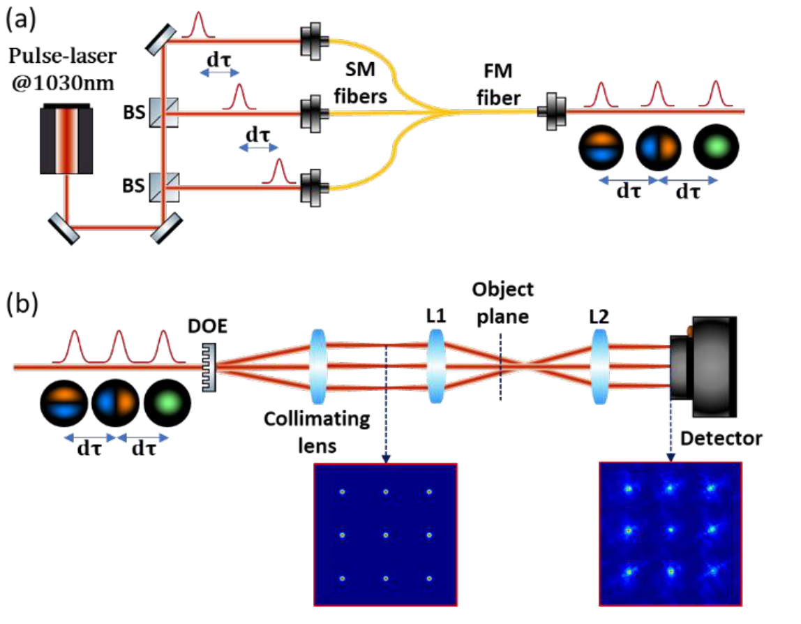
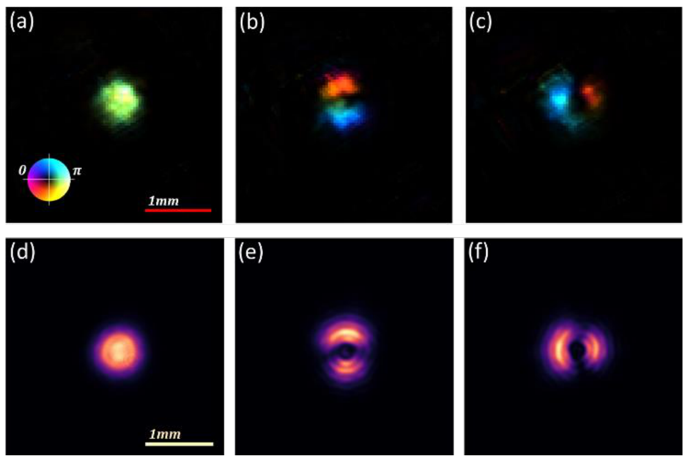
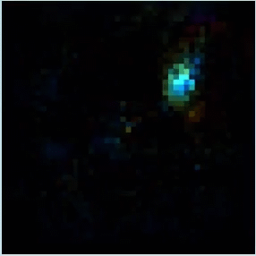
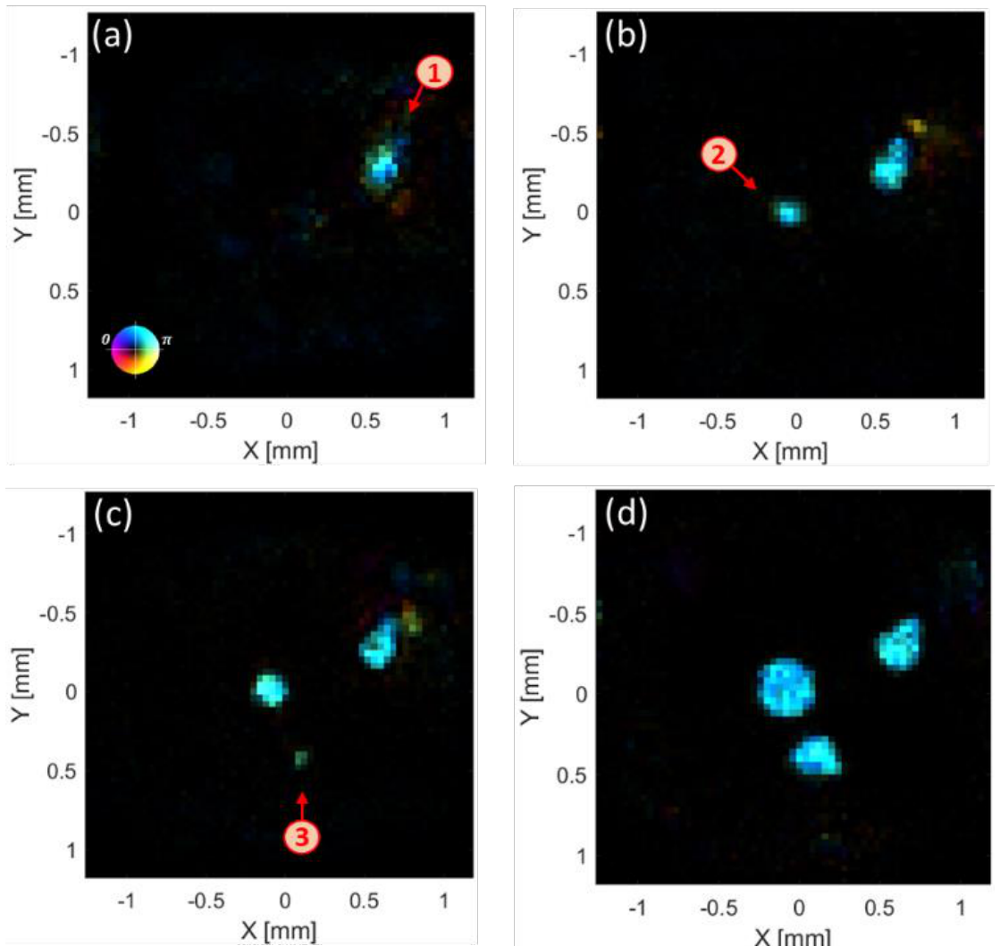

# Single-Shot Ptychographic Imaging of Non-Repetitive Ultrafast Events

**Can we capture multiple moments of an ultrafast event with just one camera exposure?**

This project, developed during my M.Sc. research at the **Technion** in **Prof. Oren Cohen's Ultrafast Optics Group**, explores how spatially coded laser pulses and computational imaging can turn a single camera snapshot into multiple **complex-valued images (amplitude + phase)**.

*Three pulses are given different spatial profiles by a photonic lantern. A 5 × 5 diffractive optical element creates overlapping illumination spots; the camera collects their multiplexed diffraction patterns in one shot.*

## 1. From phase retrieval to ultrafast imaging

The algorithmic idea evolves through a few key steps:

**1. Phase retrieval / CDI** (recover lost optical phase) → 
**2. Ptychography / ePIE** (exploit overlapping measurements to recover object and illumination) → 
**3. Single-Shot Ptychography** (capture all measurements at once) → 
**4. Ptychographic Information Multiplexing / MsPA** (separate mixed optical states) → 
**5. TIMP** (combining all by reconstructing mixed optical states along with objects at different moments in time).

The trick is that **temporal information is encoded optically, then separated computationally**—instead of relying on the camera to record each frame individually.

<!-- GIF SLOT: Add an optional visual walkthrough here:  -->

## 2. Two experimental demonstrations

### A. Reconstructing a burst of laser pulses — static object

Using a **known, stationary mask**, we recovered the **amplitude and phase of three different laser pulses**, separated by **3 ns**, from one camera exposure. Their reconstructed spatial profiles agree with independently recorded intensity measurements.

*Top: reconstructed complex probe fields (color encodes phase). Bottom: independently measured intensities.*

### B. Imaging a non-repetitive event — dynamic object

With the same microscope, three spatially distinct probe pulses captured the evolution of **laser-induced thermal ablation in a soot layer**. A multi-state reconstruction recovered **three complex-valued object frames** at **0, 200 and 900 ns** relative to the first probe, all from **one camera snapshot**.

*Reconstructed frames shown as an illustrative loop (not real-time playback). Each successive frame reveals a newly formed hole.*

<!-- OPTIONAL: Replace the animated preview or add the four-panel reconstruction + post-event reference:  -->

## Explore the full work

The [**M.Sc. thesis**](Thesis_Ariel_Veler.pdf) explains the physics, reconstruction algorithms and experiments; 
The [**seminar presentation**](Single-Shot%20Ptychographic%20Imaging%20of%20Non-Repetitive%20Ultrafast%20Events.pptx) is a visual walkthrough.

## Code overview

The code folder includes: 
- The `Probes` class and propagation methods for simulating probe fields 
- Reconstruction algorithms, include GS, FienupHIO, ePIE, and TIMP.
- Several `System_*` scripts that simulate the experimental system flow of SSP and TIMP. 
- Main scripts for reconstructing the experimental data recovering 3 probes and 3 objects of the main experiment.

**Related publications:** 
[Optics Letters (2024)](https://doi.org/10.1364/OL.502848) · 
[IEEE Photonics Journal (2024)](https://doi.org/10.1109/JPHOT.2024.3392728)
[CLEO 2023 conference](https://doi.org/10.1364/CLEO_AT.2023.JTu2A.27)
